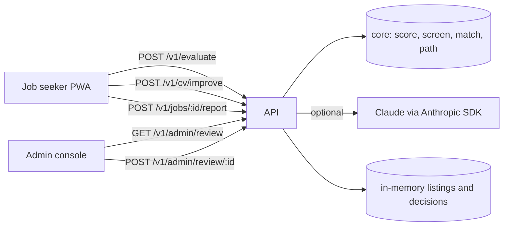

# Architecture and repository strategy

Build Your Value ships as separate deployable services, each destined for its own
repository. This repository holds the first prototype as an npm workspace so the
pieces can be developed and run together today and split without rewrites later.

## Services and their future repositories

| Folder | Future repository | What it is | Runtime |
|---|---|---|---|
| `core/` | `buildyourvalue-core` (published as a private package `@byv/core`) | Shared domain logic and types: six-component CV weakness score, scam screen, matching, learning-path builder, deterministic CV rewrite rules, sample data. No framework dependencies. | Node library (ESM) |
| `api/` | `buildyourvalue-api` | HTTP API: evaluate a profile (score + matches + path), improve a CV (Claude with rules fallback), job listings, user reports, admin review queue. | Node + Hono |
| `frontend/` | `buildyourvalue-frontend` | Job-seeker progressive web app: onboarding, dashboard, CV preview and print, digest preview, pricing. Mobile-first, installable. | Next.js |
| `admin/` | `buildyourvalue-admin` | Staff console: listing review queue with approve and reject, audit trail. Employer verification joins it in Phase 2. | Next.js |

Rules that keep the split clean:

- `frontend` and `admin` talk to `api` over HTTP only, through `NEXT_PUBLIC_API_URL`. They import `@byv/core` for types and static reference data (roles), never for scoring.
- `api` is the only service that scores, matches or calls an LLM.
- `core` has no I/O. Anything that needs a database, a network or a secret lives in `api`.
- Each folder has its own `package.json`, `tsconfig.json`, `.env.example` and scripts, so moving it to a new repository is a copy plus a dependency on the published `@byv/core`.

## How to split later

We split when the first of these happens: a second regular contributor joins, or the first production deploy is set up ([ADR-0001](adr/0001-keep-one-npm-workspace-until-split-trigger.md)).

1. Publish `core` to a private registry (GitHub Packages or npm) as `@byv/core` and pin a version.
2. Create the three service repositories and move each folder's contents to the root of its repository.
3. Replace the workspace reference `"@byv/core": "0.1.0"` with the published version.
4. Give each repository its own CI (typecheck, tests, build) and deploy target (API on Fly.io or Railway, web apps on Vercel or Cloudflare).

## Request flow in the prototype

## API endpoints

| Method and path | Purpose |
|---|---|
| `GET /health` | Liveness plus whether the AI engine is configured |
| `GET /v1/roles`, `GET /v1/courses`, `GET /v1/sample-profile` | Reference data |
| `GET /v1/jobs` | Publishable listings (automatic pass or human approved) |
| `POST /v1/evaluate` | Profile in; role, weakness report, top matches and learning path out |
| `POST /v1/cv/improve` | Profile in; improved profile, change list, before and after scores out |
| `POST /v1/jobs/:id/report` | User report; two reports suppress a listing pending review |
| `GET /v1/admin/review` | Review queue: every listing that did not pass cleanly or was reported |
| `POST /v1/admin/review/:id` | Approve or reject with reviewer identity and note |

## What is real and what is stubbed

| Area | Prototype | MVP replacement (docs/PLAN.md, Phase 1) |
|---|---|---|
| Profile storage | Browser localStorage | Supabase Postgres behind phone-OTP and Google auth |
| Job listings | 28 fictional sample listings, 4 of them scam fixtures | Nightly ingestion from JSearch/SerpApi and Remotive with dedup |
| Matching | Deterministic skill coverage, role alignment, experience, location | pgvector recall then LLM rerank of the top 30 |
| CV improvement | Rules by default; Claude structured output when `ANTHROPIC_API_KEY` is set | Same, with cost telemetry and model selection per tier |
| Digest | On-screen preview | SES or Resend send with SPF, DKIM, DMARC and one-click unsubscribe |
| Payments | Pricing page only | Paystack one-off pass and Core plan with dunning |
| Admin auth | None, localhost only | Staff SSO |
| Review decisions and user reports | In-memory | Postgres tables with audit log |
