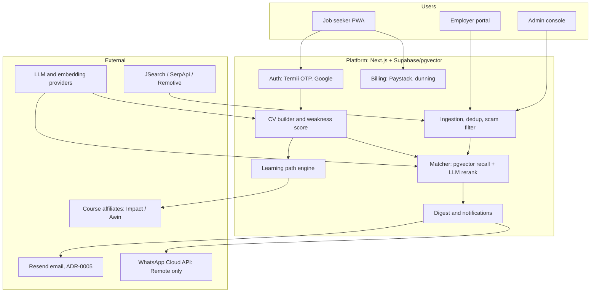

# Business Requirements Document: Build Your Value (working brand: Ladda)

*A SoundTechWorks solution. An open job board and AI-assisted career platform for every job seeker, launching in Nigeria.*

---

## 1. Document control

| Field | Value |
|---|---|
| Document title | Business Requirements Document: Build Your Value (Ladda) |
| Document ID | STW-BYV-BRD-001 |
| Version | 0.2 Draft |
| Date | 2026-10-24 |
| Owner | SoundTechWorks (product sponsor) |
| Status | Draft for review. Not approved for build. |
| Primary source | `docs/PLAN.md` and the six research notes in `docs/research/` |
| Classification | Internal. Contains unverified third-party figures; see Section 19. |

Citation convention: figures taken from the plan are cited by short section name: Summary, Market, Competitors, Naming, Pricing, Phases, Architecture, Weakness score, Launch, Compliance, Risks and metrics, Verification, Conclusion. Research notes are cited by filename. Figures absent from both are marked "TBD (verify in Phase 0)".

### 1.1 Revision history

| Version | Date | Author | Change |
|---|---|---|---|
| 0.1 | 2026-10-20 | Product team | Initial draft derived from PLAN.md and research notes |
| 0.2 | 2026-10-24 | Product team | Consistency pass after tooling research; ADR-0001 and ADR-0002 recorded |
| 0.4 | 2026-10-25 | Product team | Remote priced at ₦9,999 a month or ₦24,999 a quarter, Core held at ₦1,999 with a ₦2,499 test (ADR-0018); revenue model added (docs/REVENUE_MODEL.md) |
| 0.3 | 2026-10-24 | Product team | Guided intake (BR-064); open board for every job seeker; Nigeria remote-eligibility filter (BR-062, BR-063, BRL-017, BRL-018, INT-11); Remote tier replaces Pro; new tagline; first domain registered (ADR-0015, ADR-0017; the developer-only narrowing in ADR-0016 rejected) |

### 1.2 Approvals

| Role | Name | Signature | Date |
|---|---|---|---|
| Executive sponsor, SoundTechWorks | | | |
| Product lead | | | |
| Engineering lead | | | |
| Data protection officer / counsel | | | |
| Finance | | | |

---

## 2. Executive summary

SoundTechWorks intends to build and operate "Build Your Value", an AI-assisted career platform for Nigerian job seekers, under the recommended consumer brand **Ladda**, tagline "Build a higher value from the very place you are", parent line "a SoundTechWorks solution" (PLAN.md, Naming). The platform shall build or improve a job seeker's CV with an LLM, score the CV's weakness on six measurable components, match the seeker against a deduplicated, scam-screened corpus of Nigerian and remote postings, and email a curated digest of fit-scored jobs with a one-line explanation each. When the CV is weak for the target role, the platform recommends a curated three-step learning path whose completion triggers a re-match. Revenue comes from three lines from launch: a naira subscription (Free, a ₦1,999 one-off 7-day pass, Core at ₦1,999/month, Remote at ₦9,999/month replacing Pro; ADR-0017, ADR-0018), employer fees of ₦15,000-30,000 per featured role or shortlist, and course-affiliate commissions, with institutional (B2G/B2B2C) contracts targeted in Phase 3 (PLAN.md, Pricing; Phases). The board is open to every job seeker in every role and sector. Remote listings pass a Nigeria-eligibility classifier before they can reach a digest, because the audit of 24 October 2026 found only 7% of 601 fresh remote listings open to someone in Nigeria, and the digest shows the real count of eligible remote roles per sector rather than padding it (ADR-0017; docs/research/remote_eligibility_audit.md). The first domain, useladda.com, is registered (ADR-0015).

The research concludes that the product sells trust and relevance rather than the CV document: a reputable Nigerian vacancy draws 200-2,400 applications, 84% of adults met a scam in the past year, and no incumbent closes the CV-to-match-to-learn loop under a transparent naira price (PLAN.md, Summary; Competitors). The largest unverified assumption is that unemployed Nigerians will pay anything for job help. Delivery is therefore sequenced into four phases, beginning with an eight-week paid pilot gated on 10%+ waitlist pre-payment and 40%+ of hand-served users opening three of four digests. This BRD specifies 11 business objectives, 61 business requirements, 30 functional requirements, 22 non-functional requirements, 15 compliance requirements, 15 integrations and 16 business rules, plus financial framing, risks, milestones, gate criteria and the items to verify before money is committed.

---

## 3. Business context and problem statement

### 3.1 The Nigerian job-seeker problem

Nigeria's headline unemployment rate of 4.3% (NBS, Q2 2024) conceals a market in which 93.0% of the employed are informal and 85.6% self-employed (PLAN.md, Market). Roughly 600,000 graduates a year compete for 418,000-450,000 NYSC slots in 2026, with a backlog above 500,000. The addressable pool of formal-job seekers is estimated at 10-15 million (PLAN.md, Market). The documented pain is not a shortage of listings but a shortage of filtering, feedback and safety:

| Problem | Evidence (PLAN.md, Market unless stated) |
|---|---|
| Hopeless application ratios | 200-500 applications per reputable posting, 2,000+ for banks and multinationals; 2,400+ per average African listing |
| No feedback | "No response" is the most common complaint about Jobberman (Competitors) |
| Recruitment fraud | Fraudsters demand ₦5,000 to ₦500,000; 84% of surveyed adults encountered a scam in the past year |
| Fragmented, unverified channels | Postings spread across boards, WhatsApp, Telegram, X and Instagram; the largest Telegram channel has ~54,300 subscribers, unpersonalised |
| Skill gaps | 65% of Nigerian employers name skill gaps a major barrier; 87% call cybersecurity skills critical |
| Data cost | A 1GB bundle averages ₦475 after the January 2025 tariff rise |

### 3.2 Current alternatives and why they fail

| Alternative | Why it fails (PLAN.md, Competitors) |
|---|---|
| Jobberman AI Career Tool (₦5,200/week, ₦12,000/month, ₦35,000/quarter) | About 17% of the ₦70,000 minimum wage per month; alerts not personalised; no learning path; scam listings slip through |
| MyJobMag human rewrite (₦30,000-80,000) | One-off, expensive, no matching; roles already filled |
| Abeni AI credit packs (₦5,500-12,500) | Fit score and gap report only; no digest or path |
| HirePadi (free) | Aggregated digest, no trust layer or paid tier; defines the price floor |
| Telegram and WhatsApp channels (free) | Unfiltered firehose; offers via WhatsApp are "usually scams" (competitor_landscape.md) |
| Global tools ($19-50/month) | ₦28,000-70,000/month in USD; trial traps; Nigerian card FX caps make charges fail silently |
| Free ChatGPT | Produces a document but no verified, fit-scored distribution to real employers |

The gap to own is the combined loop (CV, fit-scored matches, learning path, re-match) wrapped in a trust layer (verified employers, listing freshness, "no fee to candidates", public scam watch) at a transparent naira price with cancel-anytime billing.

---

## 4. Business objectives and success metrics

Targets are drawn from the plan's exit criteria and metrics (PLAN.md, Phases; Risks and metrics). They derive from global benchmarks and Nigerian price anchors, not a Nigerian cohort, and must be re-baselined after Phase 1.

| ID | Objective | KPI | Target | Measured from |
|---|---|---|---|---|
| BO-01 | Prove demand before building | Waitlist pre-payment of the ₦1,999 pass | 10%+ | Phase 0 |
| BO-02 | Prove the digest is wanted | Hand-served users opening 3 of 4 digests | 40%+ | Phase 0 |
| BO-03 | Activate in one session | Sign-ups completing a CV and alert preferences; OTP drop-off | 60%+; under 15% | Phase 1 |
| BO-04 | Sustain engagement | Digest open rate | 35%+ (35-50% band) | Phase 1 |
| BO-05 | Convert free to paid | Free-to-paid conversion | 2%+ Phase 1; 4%+ by Phase 2 exit | Phase 1 |
| BO-06 | Retain payers | Monthly churn | Under 10% Phase 1; under 7% by Phase 3 | Phase 1 |
| BO-07 | Publish outcomes | Quarterly shortlist rate (active users reporting at least one interview) | Published each quarter; external bar 44-50% (LSETF pilots) | Phase 2 |
| BO-08 | Positive unit economics | Variable cost per active user (the per-user cost unit used throughout this document) | Under ₦400 per month | Phase 1 |
| BO-09 | Diversify revenue | Employer, affiliate and institutional revenue | 20 paying employers and affiliate above 5% by Phase 2 exit; B2G/B2B2C above 25% by Phase 3 exit | Phase 2 |
| BO-10 | Acquire efficiently | Blended CAC per activated user; payback | ₦700-1,500; within 3 subscription months | Phase 2 |
| BO-11 | Operate lawfully and safely | NDPC registration; fee-requesting listings in paid digests; Gmail spam rate | Before 200th data subject; zero; under 0.1% | Phase 1 |

---

## 5. Scope

### 5.1 In scope by phase (PLAN.md, Phases)

| Phase | Timing | In scope |
|---|---|---|
| 0: Validate | Months 0-2 | CAC status confirmation; name, domain, trademark and handle checks; 300-respondent willingness-to-pay survey; landing page and waitlist; 50 CVs rebuilt by hand with an LLM; manually curated weekly email digests with tracking, sent from a separate digest subdomain with SPF, DKIM, DMARC and RFC 8058 headers from the first send; Paystack pre-orders of the ₦1,999 pass; Termii sender-ID registration (telco whitelisting takes weeks); Transfer Impact Assessment for offshore hosting and inference (CR-15); hand-labelling of 300-500 Nigerian listings for the scam classifier and 200 profile/job pairs for matching evals; remote-eligibility audit of the public feeds (done 24 October 2026) and a worldwide-employer list curated by sector with weekly open-role counts |
| 1: MVP | Months 2-5 | Next.js mobile PWA; Supabase Auth with Termii phone OTP and Google sign-in; CV builder on JSON Resume with PDF/DOCX export; six-component weakness score; nightly ingestion from JSearch/SerpApi for Nigeria and from public employer job boards (Greenhouse, Lever, Ashby) and remote feeds for remote roles, with dedup, rules-based scam filter and the Nigeria-eligibility classifier; pgvector recall plus cheap-LLM rerank; email digest with one-click unsubscribe; Paystack pass and Core with dunning; NDPC registration; privacy notice disclosing automated profiling; trust cues |
| 2: Loop and growth | Months 5-10 | ESCO skill extraction; demand weights from own corpus; ~500-course curated catalogue with Impact/Awin links; three-step learning paths; re-match on completion; Remote tier (replaces Pro, ADR-0017) with WhatsApp utility notifications and opt-in digest; verified-employer badge and ₦15,000-30,000 featured roles; referral rewards in premium months; campus scholar-ambassadors; NYSC batch campaigns |
| 3: Scale and institutions | Months 10-18 | Jobberman or MyJobMag data partnership; LSETF-type B2G pilot; 3MTT credential import; cohort-dated paths with reviewer feedback; women-in-tech track; NCC zero-rating application; Ghana/Kenya and native-app evaluation |

### 5.2 Out of scope (explicitly not built)

| Item | Reason (PLAN.md section) |
|---|---|
| Native app before Phase 3 | Android ~82% of traffic; PWA is installable and push-capable; app stores take 15% (Phases; Pricing) |
| Scraping LinkedIn, Indeed or Glassdoor | hiQ v. LinkedIn: $500,000 and a permanent injunction on contract grounds (Phases; Compliance) |
| App-store billing for Nigerian subscriptions | 15% versus Paystack's 1.5% (Pricing) |
| WhatsApp marketing digests below Remote | $0.03-0.062 per message (₦84 upper bound), ~₦340-370 per user per month at the upper bound, erases Core margin (Pricing; Architecture; INT-07) |
| Showing a remote listing the user cannot legally take from their country | 85% of fresh remote listings are country-limited; an ineligible role in a paid digest is a refund and a bad review (remote_eligibility_audit.md; ADR-0017) |
| Charging users to apply or access a specific job | Charge for tools, never access; "pay to apply" is the recognised scam pattern (Launch; Compliance) |
| Storing recruiter personal data from third-party listings | Metadata only (Compliance) |
| Human CV-writing service | Automation undercuts ₦10,000-80,000 rewrites (Market) |
| Lightcast Open Skills; OpenResume (AGPL) server-side | Licence restrictions (Weakness score; Architecture) |
| Cash referral rewards | Cash referrals get farmed (Launch) |

### 5.3 Future scope (not committed)

Dollar-denominated pricing for diaspora seekers; foreign employers paying for pre-vetted candidates; employer ATS integrations; Ghana and Kenya; telco zero-rated bundle; sponsored cohorts; native app once Phase 3 metrics justify it (PLAN.md, Phases; Pricing).

---

## 6. Stakeholders and user personas

### 6.1 Stakeholders

| Stakeholder | Interest | Influence |
|---|---|---|
| SoundTechWorks executive sponsor | Funds the venture, owns brand and CAC entity, approves gates | High |
| Product and engineering | Delivers PWA, pipelines and integrations within cost envelope | High |
| Data protection officer and counsel | NDPA/GAID compliance, NDPC registration, Labour Act opinion, consent | High |
| Finance | Pricing, VAT, settlement, cost ceilings | Medium |
| Job seekers (three segments) | Shortlists, feedback, safety, affordable price | High |
| Employers and SME recruiters | Pre-scored candidates well below Jobberman's ₦100,000 listing | Medium |
| Course providers and affiliate networks | Learner referrals; commission terms | Medium |
| Institutional partners (LSETF, 3MTT, state agencies, campuses) | Digital placement layer; per-placed contracts | Medium, High in Phase 3 |
| Paystack and job-data vendors | Merchant compliance; API terms, attribution, quotas | Medium |
| Regulators: NDPC, CAC, FIRS/NRS, Ministry of Labour, NITDA | Registration, tax, licensing, Startup Act label | High (gating) |

### 6.2 User personas

| Persona | Profile (PLAN.md, Market) | Jobs to be done | Constraints |
|---|---|---|---|
| Fresh graduate / NYSC corps member | Aged 21-26; one of ~600,000 graduates a year; faces age ceilings near 25 and "2 years' experience" demands | First formal job fast; a CV that passes screening; avoid scams | Low-end Android, ₦475/GB data, volatile balance, lives on WhatsApp |
| Mid-career professional | 3-10 years' experience, often informally employed; part of the ~12-14 million LinkedIn pool | Better formal role; know why applications fail; close a credential gap (ICAN/ACCA) | Time-poor; distrusts paid career services; wants cancel-anytime |
| Remote-work seeker | Targets dollar roles; ~17% of Nigerian jobs are remote; fewer than 10% earn above $350/month; 82% prefer structured local work | Legitimate remote roles that will take a Nigerian applicant (7% of fresh remote listings on 24 October 2026); how to get paid; globally parseable CV | PayPal unusable, FX volatility, worldwide-income tax |
| SME recruiter | Hires in Lagos, Abuja, Port Harcourt; cannot justify ₦100,000 per listing | 10 pre-scored, verified-fit candidates quickly | Must pass verification; may not charge candidates |
| Institutional programme manager | Runs employability cohorts; funders expect 44-50% placement | Verified employer database, 48-hour match, placement reporting | Procurement cycles |

### 6.3 RACI

R = Responsible, A = Accountable, C = Consulted, I = Informed.

| Activity | Sponsor | Product/Eng | DPO/Counsel | Finance | Partners |
|---|---|---|---|---|---|
| Phase gate decisions | A | R | C | C | I |
| CAC confirmation and brand registration | A | I | R | C | - |
| NDPC registration and consent architecture | A | C | R | I | - |
| Labour Act licence decision | A | I | R | I | - |
| Pricing and VAT treatment | A | C | C | R | - |
| PWA, pipelines, integrations | I | R/A | C | I | C |
| Employer verification and scam watch | A | R | C | - | C |
| Course catalogue and affiliate terms | I | R/A | C | C | C |
| Institutional pilots | A | R | C | C | R |
| Quarterly shortlist-rate publication | A | R | C | I | I |

---

## 7. Proposed solution overview

The platform is a mobile-first progressive web app that takes a job seeker from sign-up to a downloadable CV and weakness score in one session. A nightly pipeline ingests, deduplicates and scam-screens postings, embeds them into pgvector, recalls the top 300 per user by hard filters and similarity, reranks the top 30 with a cheap LLM against a rubric that emits a 0-100 fit score and a one-line "why you fit", and emails the result with one-click unsubscribe. When the score shows a skills gap, the platform assembles a three-step learning path from a curated catalogue; module completion triggers a re-match that visibly lifts the fit score. Billing runs through Paystack web checkout on a pass, Core and Remote, with dunning and transfer fallbacks. Employers post verified roles and buy fit-scored shortlists; course providers pay affiliate commissions (PLAN.md, Phases; Architecture; Weakness score).

### 7.1 User journey

### 7.2 Business-level architecture

---

## 8. Business requirements

Priority uses MoSCoW: M (Must), S (Should), C (Could), W (Won't this release). Phase is the earliest delivery phase. Rationale cites the plan section.

### 8.1 Trust and safety

| ID | Requirement | Rationale | Pri. | Phase | Acceptance criterion |
|---|---|---|---|---|---|
| BR-001 | The platform shall display the SoundTechWorks CAC number and "a SoundTechWorks solution" in the footer, privacy notice and Paystack descriptor. | Statement charge must match trusted brand (Naming; Launch) | M | 1 | All three locations show parent name and number |
| BR-002 | The platform shall state prominently that it never charges users to apply and that no employer may charge candidates. | "Pay to apply" is the recognised scam pattern (Launch) | M | 1 | Statement on landing, pricing and every job page |
| BR-003 | The platform shall screen every listing with a rules layer (fee requests, webmail-only contact, WhatsApp-only application, missing company domain, "no experience" with high pay), with LLM classification and human review of borderline cases. | Scam listings slip through even at Jobberman (Architecture; Competitors) | M | 1 | 100% of listings carry a screen result; none flagged "fee" is sent |
| BR-004 | The platform shall publish an employer-verification policy and award a verified badge only after corporate-domain and CAC checks. | Trust cues belong in the MVP (Launch) | M | 1 policy, 2 badge | Policy live; badge requires logged verification |
| BR-005 | The platform shall let any user report a listing and suppress it from digests pending review within one business day. | User reporting is part of the filter (Architecture; one report suppresses, ADR-0010) | M | 1 | Report control on every listing; SLA logged |
| BR-006 | The platform shall operate a public scam watch of confirmed fraudulent postings and impersonated employers. | One fake listing in a paid digest could be fatal (Risks and metrics) | S | 2 | Page updated at least weekly |
| BR-007 | The platform shall publish a named, photographed team page, use a corporate email domain and honour a 7-day refund. | Nigerian caution reflects fraud experience (Launch) | M | 1 | All three present before first paid checkout |
| BR-008 | The platform shall exclude listings older than the freshness threshold and report the share expired at send time. | Stale roles are the top MyJobMag complaint (Competitors) | M | 1 | Freshness metric per digest run; BRL-003 enforced |

### 8.2 CV builder

| ID | Requirement | Rationale | Pri. | Phase | Acceptance criterion |
|---|---|---|---|---|---|
| BR-009 | The platform shall deliver a downloadable CV and weakness score before any payment screen. | Free value first, as ALX and uLesson (Launch) | M | 1 | No payment prompt reachable before CV download |
| BR-010 | The platform shall build a CV from a guided form or an uploaded PDF/DOCX and store it as JSON Resume extended with ESCO skill URIs, target roles, locations and naira salary expectation. | Open MIT schema plus matching fields (Architecture) | M | 1 | Both paths yield a valid extended record |
| BR-011 | The platform shall export PDF and DOCX in a single-column, ATS-safe layout. | Parse-ability is a scored component (Weakness score) | M | 1 | Exports re-parse to identical sections; no tables or images |
| BR-012 | The platform shall compute a six-component weakness score (skill coverage, achievement quality, completeness, tenure and gaps, parse-ability, missing credentials) with one explanation per component. | Weakness must be measurable (Weakness score) | M | 1 | Six scores and six explanations on every CV |
| BR-013 | The platform shall flex thresholds by seniority so fresh graduates are not penalised for missing leadership signals. | Seniority-adaptive rubric (Weakness score) | M | 1 | Same content scores differently by documented seniority rules |
| BR-014 | The platform shall apply Nigeria-specific checks: NYSC status, ICAN/ACCA for accounting targets, recognised certificates for cybersecurity targets, Pidgin role synonyms. | Discharge certificate and Big Four preferences (Weakness score) | M | 1 | Checks documented in the rubric and visible to users |
| BR-015 | The platform shall offer posting-specific tailoring metered by tier (Free none; Pass and Remote unlimited; Core 5 per month) and cover letters on Core and above. | Tier definitions (Pricing) | M | 1; Remote 2 | Quotas enforced; counter visible |
| BR-064 | The platform shall run a guided intake of at most seven tappable questions (roles or "help me choose", where to work from and whether abroad, experience, salary floor, deal-breakers, must-haves, start date) whose answers populate the structured preferences the matcher uses; the model may rephrase a question but never adds options, ranks jobs or decides what a user sees, and the fixed copy serves when no model is available. | A short conversation beats a blank form on a low-end Android and makes the first digest personal; keeps matching deterministic and explainable (ADR-0003; GAID profiling disclosure) | M | 1 | `core/src/intake.ts` with tests; `POST /v1/intake/next`; onboarding step live with form fallback; the matcher hides listings that state a chosen deal-breaker, lifts and explains those that state a chosen must-have, honours the salary floor (`core/src/attributes.ts`), and the dashboard says how many roles were hidden and why with a one-tap show and undo |
| BR-016 | The platform shall route CV writing to a stronger model and all other tasks to a cheaper model, with cached profile prefixes. | CV writing dominates LLM cost (Architecture; Sonnet 5.5 and Haiku 5.5, ADR-0003) | S | 1 | Routing configurable; per-task cost logged |

### 8.3 Job matching and digest

| ID | Requirement | Rationale | Pri. | Phase | Acceptance criterion |
|---|---|---|---|---|---|
| BR-017 | The platform shall ingest postings nightly from licensed aggregators for Nigeria and from public employer job boards (Greenhouse, Lever, Ashby) and remote job feeds (Remotive, Remote OK, Himalayas) for remote roles, into a source-agnostic JobPosting-like schema. | No free API covers Nigeria; remote supply is free, structured and legal to read (Architecture; remote_eligibility_audit.md) | M | 1 | New source added without schema change |
| BR-018 | The platform shall deduplicate with MinHash/LSH recall, embedding and field-agreement confirmation, and clustering that keeps the earliest complete record with all source URLs. | True duplicates may share only 37% text (Architecture) | M | 1 | Duplicate rate in sampled digests under 5% |
| BR-019 | The platform shall show Remotive and Remote OK listings attributed and linked per their terms, outside any sign-up wall, and never use them to collect sign-ups. | Board terms (Architecture; Compliance) | M | 1 | Public attributed page; compliance sign-off |
| BR-020 | The platform shall match in two stages: hard filters and pgvector recall of 300, then LLM rerank of 30 in batches of ten against a rubric yielding a 0-100 score and one-line explanation. | Explainability at one tenth the cost (Architecture) | M | 1 | Every digest job has score and "why"; rerank cost logged |
| BR-021 | The platform shall send digests by tier: Free weekly (5 jobs), Pass daily, Core three times weekly (30 reranked per week), Remote as Core plus the eligible remote shelf and WhatsApp. | Tier definitions and free throttle (Pricing; Architecture) | M | 1; Remote 2 | Scheduler enforces cadence and counts |
| BR-022 | The platform shall link every job to its original posting with provenance and shall not host applications. | Metadata only; link out (Compliance) | M | 1 | Outbound link and source label on every card |
| BR-023 | The platform shall let users mark jobs relevant or not and record applied, interviewed or shortlisted. | Precision and shortlist rate depend on it (Risks and metrics) | M | 1 | Feedback stored per job per user |
| BR-024 | The platform shall offer human review of any match decision on request. | GAID profiling disclosure (Compliance) | M | 1 | Response within 5 business days logged |
| BR-025 | The platform shall key embeddings to content hashes, re-embed changed postings, expire closed ones, and run scheduled reranks through batch APIs. | Stale embeddings; 50% batch discount (Architecture) | S | 1 | Nightly expiry job; batch mode default |
| BR-062 | The platform shall classify every remote listing as open, restricted or unclear for the user's country from its country list, location label and text; only open listings reach a digest, unclear ones enter the human review queue, and the digest states the number of eligible remote roles per sector without padding. | 7% of 601 fresh remote listings were open to Nigeria on 24 October 2026 (remote_eligibility_audit.md; ADR-0017) | M | 1 | `classifyRemoteEligibility` in core with tests; weekly 50-row precision check at or above 80%; zero restricted listings in sampled digests |
| BR-063 | The platform shall maintain a curated list of employers that hire worldwide, grouped by sector, and report weekly how many fresh open roles each sector yields. | Open remote roles cluster at a few employers (Canonical 82% open, Supabase 66%); supply is a list to curate (remote_eligibility_audit.md) | S | 1 | Weekly per-sector report; list grows only with proven supply |

### 8.4 Learning path

| ID | Requirement | Rationale | Pri. | Phase | Acceptance criterion |
|---|---|---|---|---|---|
| BR-026 | The platform shall extract ESCO skills from CVs and postings and derive demand weights from its own last-90-days Nigerian postings per title. | Coverage must reflect local demand (Weakness score) | M | 2 | Weights refreshed monthly |
| BR-027 | The platform shall trigger a learning path when skill coverage is below 50% or a role credential is missing. | Documented threshold (Weakness score) | M | 2 | Trigger fires at threshold in tests |
| BR-028 | The platform shall assemble a three-step path with an explicit time budget from a curated ~500-course catalogue weighted to free content (3MTT, ALX, Google certificates via Coursera aid, Alison, Udemy). | Catalogue APIs gated; budgets lift completion (Weakness score) | M | 2 | Three steps, time budget and a free option where available |
| BR-029 | The platform shall label outcome claims "provider-reported" and never imply Nigerian placement rates. | 3MTT placed ~15,000 of ~390,000 (Weakness score) | M | 2 | Label on every outcome statement |
| BR-030 | The platform shall re-match on module completion and show the fit-score change. | The loop must visibly close (Weakness score) | M | 2 | Delta shown within 24 hours |
| BR-031 | The platform shall pair remote, BPO and virtual-assistant paths with a "getting paid" module. | PayPal unusable; 2025 tax reform (Weakness score) | S | 2 | Module on all remote-track paths |
| BR-032 | The platform shall support cohort-dated paths with reviewer feedback and a women-in-tech track. | Cohorts and mentorship lift completion (Weakness score; Launch) | C | 3 | One cohort path and the track live |
| BR-061 | The platform shall offer Remote subscribers a text mock interview generated from a target posting, graded against a STAR rubric with written feedback; voice mode is future scope. | Remote tier sells a mock interview (Pricing; ADR-0017); text first, voice after a Nigerian-English STT test (TOOLING.md) | S | 2 | Eight-question session with per-answer feedback; no fabricated facts about the candidate |

### 8.5 Subscription and payments

| ID | Requirement | Rationale | Pri. | Phase | Acceptance criterion |
|---|---|---|---|---|---|
| BR-033 | The platform shall offer Free (₦0), Finished CV pass (₦1,999, 7 days), Core (₦1,999/month) and Remote (₦9,999/month or ₦24,999/quarter; replaces Pro, ADR-0017, priced by ADR-0018), VAT-inclusive. | Pricing table (Pricing; Compliance) | M | 1; Remote 2 | Checkout matches the table |
| BR-034 | The platform shall take all Nigerian payments through Paystack web checkout and never app-store billing. | 1.5% versus 15% (Pricing) | M | 1 | No app-store SKU exists |
| BR-035 | The platform shall accept cards, bank transfer, USSD and OPay/PalmPay wallet top-ups. | Volatile balances (Pricing) | M | 1 | Each method completes a test purchase |
| BR-036 | The platform shall let subscribers choose their charge date and run 3-5 dunning retries over 7-10 days with SMS or WhatsApp reminders. | 8-14% involuntary failure per cycle (Pricing) | M | 1 | Schedule configurable; recovery rate reported |
| BR-037 | The platform shall offer NIBSS direct debit only on quarterly and annual plans. | Not cost-effective under ₦5,000 (Pricing) | S | 2 | Absent from monthly checkout |
| BR-038 | The platform shall refund any first purchase within 7 days. | Trust cue (Launch) | M | 1 | Refund within 5 business days of request |
| BR-039 | The platform shall prompt pass holders to upgrade on expiry and report pass-to-subscription conversion. | Monetisation metric (Risks and metrics) | M | 1 | Prompt shown; metric in dashboard |
| BR-040 | The platform shall allow two-tap cancellation without dark patterns and show the next charge on every billing page. | Cancel-anytime positioning (Competitors) | M | 1 | Cancellation audit passes |
| BR-041 | The platform shall review naira prices at least annually against inflation and FX. | ~16% inflation; naira near ₦1,380/$ when observed (Market), against the §14 anchor of ₦1,400/$ | S | 1 | Annual review documented |

### 8.6 Employer side

| ID | Requirement | Rationale | Pri. | Phase | Acceptance criterion |
|---|---|---|---|---|---|
| BR-042 | The platform shall let employers post structured roles after domain and CAC verification. | Verified badge and pre-scored applicants (Pricing) | M | 2 | Unverified postings never reach digests |
| BR-043 | The platform shall sell featured roles and 10-candidate fit-scored shortlists at ₦15,000-30,000. | Room under Jobberman's ₦100,000 (Pricing) | M | 2 | Prices live; 20 paying employers by Phase 2 exit |
| BR-044 | The platform shall require employers to accept a no-fee-to-candidates term and remove violators. | No employer may charge candidates (Launch) | M | 2 | Term in agreement; removal procedure documented |
| BR-045 | The platform shall share only candidates who consented to that shortlist and show employers the same fit score candidates see. | Consent-based processing; consistency (Compliance; Architecture) | M | 2 | Consent record per candidate per shortlist |

### 8.7 Partnerships and affiliates

| ID | Requirement | Rationale | Pri. | Phase | Acceptance criterion |
|---|---|---|---|---|---|
| BR-046 | The platform shall route course links through disclosed affiliate programmes (Impact, Awin, Udemy) and rank free sources first. | Coursera up to 45%, Udemy 10% (Pricing) | M | 2 | Disclosure on every link; free option first |
| BR-047 | The platform shall pursue a direct Jobberman or MyJobMag feed to replace aggregator spend. | Highest-value source; lower legal risk (Architecture) | S | 3 | Signed agreement or documented refusal |
| BR-048 | The platform shall support an institutional mode: cohort enrolment, verified employer database, 48-hour match and placement reporting. | LSETF/UNDP 48-hour database is the B2G version (Launch) | S | 3 | One pilot contract and placement report |
| BR-049 | The platform shall import 3MTT credentials as CV evidence and apply for NCC zero-rating of learning content. | 3MTT fellows are the target users; education bundles have precedent (Risks and metrics; Launch) | C | 3 | Import tested; application submitted |

### 8.8 Growth and referral

| ID | Requirement | Rationale | Pri. | Phase | Acceptance criterion |
|---|---|---|---|---|---|
| BR-050 | The platform shall reward referrals with premium months or tailorings only after the referred user completes a CV. | Kuda-style gating prevents farming (Launch) | M | 2 | Reward issued on CV-completion event only |
| BR-051 | The platform shall run a campus scholar-ambassador programme of about twenty ₦100,000 awards per year. | Cowrywise precedent on 80+ campuses (Launch) | S | 2 | Sign-ups tracked by campus |
| BR-052 | The platform shall time acquisition campaigns to NYSC registration and passing-out dates. | 100,000+ graduates need a CV at once (Market; Launch) | M | 2 | Campaign calendar aligned to NYSC dates |
| BR-053 | The platform shall publish city-tagged job pages and "how to write a CV for X" content from Phase 1. | 12+ months to rank; "jobs in abuja" ~112,100 searches (Launch) | S | 1 | Pages indexed; organic traffic tracked |
| BR-054 | The platform's brand voice shall use standard Nigerian English, leaving Pidgin to creators. | Forced slang reads as fake (Launch) | S | 1 | Tone guide approved |

### 8.9 Analytics and reporting

| ID | Requirement | Rationale | Pri. | Phase | Acceptance criterion |
|---|---|---|---|---|---|
| BR-055 | The platform shall measure the activation funnel including OTP delivery by carrier and session-one completion. | Activation metrics (Risks and metrics) | M | 1 | Funnel by step and carrier |
| BR-056 | The platform shall measure digest open and click by channel, weekly active share, 30-day return and digest precision. | Engagement and quality (Risks and metrics) | M | 1 | Metrics per cohort |
| BR-057 | The platform shall measure listing freshness, scam reports per 1,000 listings and Postmaster spam rate. | Quality metrics (Risks and metrics) | M | 1 | Alert above 0.1% spam |
| BR-058 | The platform shall measure free-to-paid by tier, pass upgrades, ARPU, voluntary versus involuntary churn, dunning recovery, 90-day re-subscription and revenue by line. | Monetisation; episodic retention (Risks and metrics) | M | 1 | Monthly finance report from platform data |
| BR-059 | The platform shall measure variable cost per active user split by job-data, LLM, email and WhatsApp. | Cost ceiling ₦400 (Risks and metrics) | M | 1 | Weekly cost view |
| BR-060 | The platform shall publish the quarterly shortlist rate, path completion by module and fit-score lift after courses. | Outcome metrics (Risks and metrics) | M | 2 | Published each quarter |

---

## 9. Functional requirements summary (MVP)

| ID | Feature | Functional behaviour | Traces to |
|---|---|---|---|
| FR-001 | Onboarding | Phone-first sign-up; OTP by SMS with automatic WhatsApp and voice fallback; rate limits; Google sign-in as second path; guided intake of up to seven tappable questions with the form as fallback. | BR-055, BR-064 |
| FR-002 | Consent capture | Three separate unticked checkboxes: CV processing and matching; job-alert emails as contracted service; promotional and partner emails. | BR-024, BR-045 |
| FR-003 | Preferences | Target roles, locations, country of residence (drives remote eligibility), local or remote or both, seniority, naira salary expectation, NYSC status. | BR-010, BR-014, BR-062, BR-064 |
| FR-004 | CV from form | Guided sections with LLM rewriting of bullets into results-first language. | BR-010, BR-012 |
| FR-005 | CV from upload | PDF/DOCX text extraction; LLM structured output to extended JSON Resume; user confirms fields. | BR-010 |
| FR-006 | CV export | PDF via headless Chromium; DOCX via the `docx` library; ATS-safe templates. | BR-011 |
| FR-007 | Weakness score | Six components, seniority-flexed; explanation and remedy per component; recomputed on edit. | BR-012 to BR-014 |
| FR-008 | Tailoring and cover letters | Posting-specific variants with per-tier quotas. | BR-015 |
| FR-009 | Job ingestion | Nightly 50-100 Nigerian role-and-city queries; public employer boards and remote feeds within their terms; eligibility classification on every remote listing; normalise with source URL. | BR-017, BR-019, BR-062, BR-063 |
| FR-010 | Deduplication | MinHash/LSH candidates, embedding and field confirmation, clustering, canonical record. | BR-018 |
| FR-011 | Scam and eligibility filter | Rules, LLM classifier, verified-domain whitelist, user reports; status pass, review or reject; remote-eligibility status open, restricted or unclear with reasons. | BR-003, BR-005, BR-062 |
| FR-012 | Embedding | Postings and profile summaries into pgvector keyed by content hash; re-embed and expire. | BR-020, BR-025 |
| FR-013 | Matching | Filter and recall 300; rerank 30 in batches of ten in batch mode; store score and explanation. | BR-020, BR-025 |
| FR-014 | Digest scheduling | Tier cadence and counts; send-time preference; plain-text alternative; RFC 8058 headers; immediate one-click unsubscribe. | BR-008, BR-021 |
| FR-015 | Job feedback | Relevant, applied, interviewed, shortlisted actions per job. | BR-023, BR-060 |
| FR-016 | Human review | Request form; ticket tracked to closure. | BR-024 |
| FR-017 | Checkout | Paystack web checkout for pass and Core; VAT-inclusive; parent descriptor. | BR-001, BR-033, BR-034 |
| FR-018 | Recurring billing | Tokenised card after initial 2FA charge; user-chosen charge date; subscription state machine. | BR-036 |
| FR-019 | Dunning | 3-5 retries over 7-10 days; reminders; transfer, USSD and wallet fallback; grace before downgrade. | BR-035, BR-036 |
| FR-020 | Refunds and cancellation | 7-day refund flow; two-tap cancel; next-charge disclosure. | BR-038, BR-040 |
| FR-021 | Pass expiry | Downgrade to Free on day 7 with upgrade prompt; conversion tracked. | BR-039 |
| FR-022 | Learning catalogue | Admin CSV of ~500 courses with provider, cost, affiliate link, ESCO skills, provider-reported label. | BR-028, BR-029, BR-046 |
| FR-023 | Learning path | Nearest courses per gap skill from pgvector; LLM assembles three steps with budget; free first; completion triggers re-match. | BR-027, BR-028, BR-030 |
| FR-024 | Employer posting | Account, structured form, domain and CAC verification, no-fee term, payment for featured role or shortlist. | BR-042 to BR-044 |
| FR-025 | Shortlist delivery | 10 consenting candidates ranked by fit score delivered to employer. | BR-045 |
| FR-026 | Admin: scam review | Queue with rule hits and classifier output; approve, reject, whitelist or blacklist domain. | BR-003, BR-005, BR-006 |
| FR-027 | Admin: employer verification | Pending queue with domain and CAC evidence; decision log. | BR-004, BR-042 |
| FR-028 | Trust pages | Team, verification policy, scam watch, refund, "never charge to apply", CAC number. | BR-001, BR-002, BR-006, BR-007 |
| FR-029 | Referral | Unique link; reward on referred user's CV completion. | BR-050 |
| FR-030 | Analytics | Event pipeline feeding funnel, engagement, quality, monetisation, cost and outcome dashboards. | BR-055 to BR-060 |

---

## 10. Non-functional requirements

| ID | Category | Requirement | Target | Source |
|---|---|---|---|---|
| NFR-001 | Performance | Usable on a low-end Android device over 3G. | First contentful paint under 3 s on a 3G profile; initial JavaScript under 150 KB gzipped, enforced by a CI budget file | PLAN.md, Architecture |
| NFR-002 | Data budget | First session from landing to CV download consumes a few megabytes at most. | Under 3 MB, TBD (verify in Phase 1) | PLAN.md, Launch |
| NFR-003 | Media | WebP/AVIF images; no autoplay media; plain-text MIME alternative in digests. | 100% | PLAN.md, Architecture |
| NFR-004 | Installability | PWA installable and push-capable on Android Chrome (manifest today; service worker and Web Push arrive in Phase 1 via Serwist, Turbopack compatibility unverified). | Lighthouse PWA checks pass | PLAN.md, Phases |
| NFR-005 | Availability | User-facing services available monthly; nightly pipeline completes before 06:00 WAT. | 99.5%; SLA met 95% of nights, TBD (verify in Phase 1) | Derived |
| NFR-006 | Latency | Database in London (eu-west-2) by default, Frankfurt only if measured Lagos round trips say so (Cape Town is not a Supabase region, per an unverified snippet); CDN with Lagos point of presence. | Region decision documented with measurements | PLAN.md, Architecture |
| NFR-007 | Security: transport and storage | TLS 1.2+ in transit; CVs and personal data encrypted at rest, with phone, email and any national ID or bank detail also encrypted at the application level with AES-GCM (ADR-0009); secrets in a managed vault. | Configuration audit | Standard practice |
| NFR-008 | Security: authentication | 5-minute OTP expiry; rate limits; Google OAuth; session revocation. | No high-severity auth finding | gtm_and_naming.md |
| NFR-009 | Security: application | Assessed against OWASP Top 10 before each gate. | No open high or critical findings | Standard practice |
| NFR-010 | Privacy: minimisation | Collect only what CV building, matching and billing need; no recruiter personal data from listings. | DPO sign-off | PLAN.md, Compliance |
| NFR-011 | Privacy: retention, deletion, export | Users export their data and delete their account; deletion within 30 days; inactive accounts purged after a published period. | Tested; period TBD (verify with counsel) | PLAN.md, Compliance |
| NFR-012 | Privacy: profiling | Privacy notice discloses automated profiling and explains scores; model decisions logged. | Notice published; logs retained | PLAN.md, Compliance |
| NFR-013 | Email deliverability | Dedicated sending subdomain with SPF, DKIM and aligned DMARC; RFC 8058 one-click unsubscribe honoured immediately; gradual warm-up; Postmaster Tools monitored. | Spam rate under 0.1%; bounce under 2% | PLAN.md, Architecture |
| NFR-014 | Accessibility | WCAG 2.1 AA for onboarding, CV, digest settings and checkout. | Audit passes | Standard practice |
| NFR-015 | Localisation | English first in standard Nigerian English; documented Pidgin tone guide for creator content and optional hints; ₦ formatting. | Tone guide approved | PLAN.md, Launch |
| NFR-016 | Scalability | Serve 1,000, 10,000 and 100,000 registered users within the plan's envelope on Supabase Pro, Vercel for the web apps and Fly.io for the API (ADR-0008), and a durable job runner (pg_cron plus pgmq, then Inngest; ADR-0006). | ≈ $100-200, $500-900 and $3,500-6,000 per month (cheap-model variant) | PLAN.md, Architecture |
| NFR-017 | Cost ceiling: variable | Variable cost per active user per month without WhatsApp; "per active user" is the unit for every per-user cost figure in this document. | Under ₦400 per active user (PLAN.md quotes $0.10-0.30 per registered user at 60% weekly active) | PLAN.md, Architecture; Risks and metrics |
| NFR-018 | Cost ceiling: free tier | Free users receive the throttled pipeline (weekly digest, 20-50 scored jobs). | ≈ $0.03 per user per month | PLAN.md, Pricing; Architecture |
| NFR-019 | Observability | Pipeline runs, tokens per CV and per job, API quotas, delivery and payment events logged and alertable. | Dashboards and alerts live | PLAN.md, Verification |
| NFR-020 | Resilience | Ingestion degrades gracefully and retries with backoff; no empty digest is sent. | Failures alerted | Derived |
| NFR-021 | Portability | Ingestion schema and taxonomy country-agnostic for Ghana and Kenya evaluation. | Design review | PLAN.md, Phases |
| NFR-022 | Licensing | Only MIT, Apache-2.0 or equivalent components embedded server-side; AGPL excluded. | Licence scan passes | PLAN.md, Architecture |

---

## 11. Data, privacy and compliance requirements

| ID | Area | Requirement | Timing | Source (PLAN.md) |
|---|---|---|---|---|
| CR-01 | NDPA 2023 and GAID 2025 | Operate as a data controller with a documented lawful basis per purpose. | Before Phase 1 launch | Compliance |
| CR-02 | NDPC registration | Register as a Data Controller of Major Importance, expected Ordinary High Level (₦10,000 per year), before the 200th data subject is recorded; re-tier with counsel (EHL ₦100,000; UHL ₦250,000, with annual Compliance Audit Return). | Before 200th data subject | Compliance |
| CR-03 | DPO | Appoint and name a data protection officer. | Phase 1 | Compliance |
| CR-04 | Marketing consent | Separate unticked consent for promotional and partner email under GAID Art. 18(1)(a); objection suppresses immediately (Araka v. Jumia). | Phase 0 onward | Compliance |
| CR-05 | Automated profiling | Disclose profiling, explain match scores, offer human review. | Phase 1 | Compliance |
| CR-06 | Breach and retention | Documented and tested breach procedure, retention schedule and deletion policy. | Phase 1 | Compliance |
| CR-07 | CAC coverage | SoundTechWorks builds and owns the product and the brand is its trading name (ADR-0002). Confirm that SoundTechWorks is a CAC limited company and that its registered objects cover the product; restructure or extend the objects first if not; display its RC number. | Phase 0 | Naming; Phases; Compliance |
| CR-08 | Startup Act 2022 | If held by a Nigerian Ltd under 10 years old with at least one-third Nigerian shareholding, apply for the NITDA Startup Label; verify reported incentives before relying on them. | After incorporation decision | Compliance |
| CR-09 | VAT | Prices VAT-inclusive at 7.5% under the Nigeria Tax Act 2025; register when turnover exceeds the small-company exemption (turnover ≤₦100 million and fixed assets ≤₦250 million). | Phase 1 | Compliance |
| CR-10 | Labour Act licence | Obtain a written opinion before launch on whether an AI matching marketplace is a "private employment agency" (ss. 23, 25, 71); keep the stance "tools and information, never placement fees"; obtain the state licence if advised. | Before Phase 1 launch | Compliance |
| CR-11 | Third-party data terms | Remotive attributed, linked, within rate limits, never for sign-up collection; aggregator terms, robots.txt and ToS respected; no scraping of LinkedIn, Indeed or Glassdoor (hiQ v. LinkedIn: $500,000 and a permanent injunction). | Phase 1 | Compliance; Architecture |
| CR-12 | Employer data | Store job metadata only; share candidate data with employers only on per-role consent. | Phase 1-2 | Compliance |
| CR-13 | AI governance | Log model decisions; monitor NITDA AI guidance; review GAID "emerging technologies" provisions with counsel. | Phase 1 onward | Compliance |
| CR-14 | Marketing claims | No use of "85% of graduates lack digital skills" without the ~100-person sample caveat; provider outcomes labelled provider-reported. | Phase 0 onward | Weakness score |
| CR-15 | Cross-border transfers | Transfer Impact Assessment and cross-border transfer basis under GAID 2025 for Supabase (London), Vercel, Resend, PostHog, Sentry and Anthropic inference; owner counsel. | Phase 0 | Compliance; TOOLING.md |

---

## 12. Integration and data-source requirements

| ID | Integration | Purpose | Phase | Commercial and legal notes (PLAN.md) | Fallback |
|---|---|---|---|---|---|
| INT-01 | JSearch, SerpApi Google Jobs or DataForSEO | Nigerian postings via Google-for-Jobs data | 1 | JSearch ~$30/month per 10,000 requests; SerpApi from $50/month; DataForSEO $0.0006 per page; 50-100 daily queries cost $30-130/month (Architecture) | Switch vendor; TheirStack at scale |
| INT-02 | Remotive, Remote OK and Himalayas public APIs | Remote roles from job boards | 1 | Free; attribution and link-back for Remotive and Remote OK; Remotive now returns ten listings; Himalayas lists allowed countries per job (remote_eligibility_audit.md) | Public employer boards (INT-11) |
| INT-11 | Greenhouse, Lever and Ashby public job-board APIs | Remote roles direct from employers that hire worldwide | 1 | Public JSON, no key, no cost; region labels drive eligibility; ask the employer directly as volume grows | Remote boards (INT-02) |
| INT-03 | Jobberman or MyJobMag feed | Replace aggregator spend | 3 | No public API or RSS found; partnership required (Architecture) | Aggregators; TheirStack |
| INT-04 | LLM provider (Haiku 5.5 for rerank and classification; Sonnet 5.5 for CV writing; ADR-0003) | Rerank, scam classification, CV generation, path assembly | 1 | Indicative $0.10/$0.50 per million tokens; batch 50% off; verify (Architecture; Verification) | Second provider behind an abstraction |
| INT-05 | voyage-4-lite at 1,024 dimensions (ADR-0007; text-embedding-3-small at 1,536 as alternative) and pgvector | Recall; course retrieval | 1 | $0.02 per million tokens; HNSW with halfvec (Architecture) | Alternative embedding model |
| INT-06 | Resend (ADR-0005; Amazon SES at scale) | Digest and transactional email | 1 | SES ~$0.10 per 1,000; Resend Pro 50,000 for $20; SPF/DKIM/DMARC (Architecture) | Switch provider; dedicated IPs at scale |
| INT-07 | WhatsApp Cloud API via Meta or a BSP | Remote digest and utility notifications | 2 | Per-message billing since 1 July 2025; a separate charge on service replies after 1,000 free per number from 1 October 2026 (single vendor source); utility ~₦14, marketing $0.03-0.062 (₦84 upper bound), unverified (Architecture; Verification) | Email only; SMS for critical notices |
| INT-08 | Termii | SMS OTP with WhatsApp and voice fallback | 1 | Prepaid naira wallet; SMS ₦5.62-7.00 per page; unit prices dashboard-only (Architecture) | Second OTP provider; Google sign-in |
| INT-09 | Paystack | Checkout, recurring charges, direct debit, transfer, USSD, refunds | 1 | 1.5% + ₦100 capped at ₦2,000; ₦100 waived under ₦2,500 (Pricing) | Flutterwave or Monnify (rates disputed) |
| INT-10 | Supabase | Postgres, pgvector, Auth, Storage | 1 | Pro $25/month to ~100,000 MAU (Architecture) | Self-hosted Postgres on Hetzner |
| INT-11 | pg_cron plus pgmq in Supabase, then Inngest from Phase 2 (ADR-0006) | Nightly ingestion, embedding, matching, fan-out | 1 | $0-25/month at 1,000 users (Architecture) | pg-boss on VPS |
| INT-12 | Impact (Coursera), Awin (Alison), Udemy affiliates | Commissions | 2 | Coursera up to 45%; Udemy 10% base, 7-day cookie, app sales excluded; catalogue APIs gated (Pricing; Architecture) | Curated CSV without tracking |
| INT-13 | ESCO v1.2.1 | Skills taxonomy | 2 | Free for commercial use; CSV/JSON-LD; API under EUPL 1.2 (Weakness score) | LLM output constrained to ESCO labels |
| INT-14 | 3MTT and LSETF systems | Credential import; cohort and placement reporting | 3 | Terms TBD (verify in Phase 3) | Manual CSV import |
| INT-15 | Cloudflare | CDN and edge | 1 | Lagos point of presence since 2018 (Architecture) | Vercel edge network |

---

## 13. Business rules

| ID | Rule | Source (PLAN.md) |
|---|---|---|
| BRL-001 | The platform never charges a user to apply for, view or be considered for a specific job; charges apply only to tools. | Launch; Compliance |
| BRL-002 | No employer may request any payment from a candidate; breach means removal and a scam-watch entry. | Launch |
| BRL-003 | A listing is not sent if older than 30 days from datePosted or past validThrough, whichever is earlier; the 30-day default is TBD (verify in Phase 1). | Risks and metrics |
| BRL-004 | A listing fails the scam screen outright if it requests any fee or uses a well-known company name without a verifiable domain (impersonation). A missing company domain, webmail-only contact, a contact domain that does not match the company domain, WhatsApp-only application, "no experience needed" with pay far above market, urgency language or an implausible entry-level salary each raise a review flag; one or two flags send the listing to human review, three or more fail it without review. | Architecture; core/src/scam.ts |
| BRL-005 | Consumer price points avoid ₦2,500-4,000 because Paystack's ₦100 flat fee applies from ₦2,500; fee-efficient points are under ₦2,500 or at ₦5,000 and above. | Pricing |
| BRL-006 | NIBSS direct debit is offered only on quarterly and annual plans. | Pricing |
| BRL-007 | A first purchase is refundable in full within 7 days. | Launch |
| BRL-008 | A failed renewal triggers 3-5 retries over 7-10 days with reminders; the account then downgrades to Free, not deletion. | Pricing |
| BRL-009 | Free users receive one weekly digest of 5 jobs drawn from 20-50 scored candidates. | Pricing; Architecture |
| BRL-010 | WhatsApp marketing digests are Remote-only; utility notifications may go to Remote and, on opt-in, Core. | Pricing; Architecture |
| BRL-011 | Learning paths recommend free sources before paid courses when a free course covers the gap skill. | Weakness score |
| BRL-012 | Every affiliate link is disclosed adjacent to the link. | Pricing |
| BRL-013 | A learning path is triggered at skill coverage below 50% or a missing role credential. | Weakness score |
| BRL-014 | Referral rewards are granted only after the referred user completes a CV, in premium months or tailorings, never cash. | Launch |
| BRL-015 | Remotive and Remote OK listings appear only with attribution and a link to the original, outside any sign-up wall. | Architecture |
| BRL-016 | All displayed prices are VAT-inclusive; naira prices are reviewed at least annually. | Compliance; Risks and metrics |
| BRL-017 | A remote listing is never shown to a user whose country of residence it does not cover; an "unclear" listing is held for human review and shown only after approval. | ADR-0017; remote_eligibility_audit.md |
| BRL-018 | A digest states the number of eligible remote roles found per sector and never fills a shortfall with ineligible roles or with local roles presented as remote. | ADR-0017 |

---

## 14. Financial summary

### 14.1 Pricing (PLAN.md, Pricing)

| Tier | Price | Includes | Paystack fee |
|---|---|---|---|
| Free | ₦0 | CV draft, weakness score with one explanation per component, weekly digest of 5 jobs, scam-checked listings | n/a |
| Finished CV pass | ₦1,999 one-off, 7 days | Unlimited tailoring and PDF/DOCX export for a week, daily digest, learning-path preview | ₦30 (1.5%) |
| Core | ₦1,999/month | Digest three times weekly, 30 reranked jobs per week with "why you fit", 5 tailorings per month, full learning path, cover letters | ₦30 (1.5%) |
| Remote (replaces Pro; ADR-0017, ADR-0018) | ₦9,999/month or ₦24,999/quarter | Core plus the eligible remote shelf with time-zone overlap shown, global-convention CV, unlimited tailoring (fair-use cap of 20 a month), getting-paid module, WhatsApp digest, mock interview, priority re-match | ₦250 at ₦9,999 (2.5%); ₦475 on the quarter (1.9%) |
| Employer | ₦15,000-30,000 per featured role or 10-candidate shortlist | Verified badge, structured posting, pre-scored applicants | Standard |

### 14.2 Illustrative revenue scenario

An illustration, not a forecast. Assumptions: 100,000 registered free users; 3% conversion; blended ARPU ₦2,500; FX anchor ₦1,400 per US dollar (October 2026), the single dated rate used for every dollar conversion in this document and in PLAN.md (PLAN.md, Pricing).

| Line | Value |
|---|---|
| Paying subscribers | 3,000 |
| Monthly gross subscription revenue | ≈ ₦7.5 million (≈ $5,400) |
| Monthly churn to refill | 5-10%, of which 20-40% from failed payments |
| Employer revenue | 20 paying employers by Phase 2 exit at ₦15,000-30,000 per role; volume TBD (verify in Phase 2) |
| Affiliate revenue | Above 5% of total by Phase 2 exit |
| Institutional revenue | Above 25% of total by Phase 3 exit |

### 14.3 Cost envelope (PLAN.md, Architecture)

| Cost line (USD per month) | 1,000 users | 10,000 users | 100,000 users |
|---|---|---|---|
| Fixed plus variable, cheap-model variant | ≈ 100-200 | ≈ 500-900 | ≈ 3,500-6,000 |
| Sonnet-class CV-writing variant | ≈ 200-300 | ≈ 1,400-1,800 | ≈ 12,000-15,000 |
| Optional weekly WhatsApp marketing digest | +160 | +1,600 | +16,000 |
| Developer tooling (two Claude subscriptions, plugins; fixed) | ≈ 200 | ≈ 200 | ≈ 200 |
| Variable cost per registered user (no WhatsApp) | $0.10-0.30 | $0.10-0.30 | $0.10-0.30 |

This is the reconciled cost table; PLAN.md's cost table is its source and points here (resolves I-2). The model assumes 60% weekly active users, 300 candidates and 30 reranked jobs per active user per week, and unit prices observed on 20 October 2026. The technical note's own totals run higher at the top end (~$6,000-15,000 at 100,000 users; technical_architecture.md).

### 14.4 Break-even framing (illustration)

At ₦1,999 (≈ $1.43) against $0.10-0.30 variable cost, a paying user is gross-margin positive, and at 3% conversion each payer subsidises about 33 free users, which is viable only with the free-tier throttle (PLAN.md, Architecture). On the scenario above, ≈ $5,400 of monthly subscription revenue against ≈ $3,500-6,000 of platform cost at 100,000 users means consumer subscription alone does not reliably cover platform cost before payment fees, support labour and acquisition. Employer, affiliate and institutional lines are therefore structural (PLAN.md, Pricing; Conclusion). All inputs require the verification in Section 19.

---

## 15. Assumptions, constraints and dependencies

| ID | Assumption | Risk if false |
|---|---|---|
| A-01 | Some unemployed Nigerian job seekers will pay ₦1,999 for a finished CV and matches. | Pivot to B2G and employer-paid model (PLAN.md, Conclusion) |
| A-02 | Young Nigerians open and act on a weekly email despite living on WhatsApp. | Channel shift raises cost 25-60x per message |
| A-03 | Google-for-Jobs aggregators yield enough fresh Nigerian listings per query. | Higher data cost or weaker digests |
| A-04 | Global benchmarks (60% activation, 35% open, 2-4% conversion, under 10% churn) are achievable ceilings. | Targets re-baselined after Phase 1 |
| A-05 | SoundTechWorks' CAC registration can carry the product or be extended cheaply. | Incorporation cost and delay |
| A-06 | Unit prices observed on 20 October 2026 hold within ±50% for 12 months. | Cost envelope revision |

| ID | Constraint |
|---|---|
| C-01 | APIs, partner feeds and authorised postings only; no scraping of LinkedIn, Indeed or Glassdoor. |
| C-02 | Web checkout only; no app-store billing. |
| C-03 | First-session budget of a few megabytes; initial JavaScript under 150 KB gzipped, enforced by a CI budget file. |
| C-04 | NDPC registration before the 200th data subject. |
| C-05 | WhatsApp marketing confined to Remote. |
| C-06 | Permissive open-source licences only for embedded components. |
| C-07 | VAT-inclusive naira pricing with annual review. |

| ID | Dependency | Owner |
|---|---|---|
| D-01 | Phase 0 gate results (10%+ pre-pay, 40%+ open) | Sponsor |
| D-02 | CAC confirmation; name, domain, trademark and handle checks | Counsel |
| D-03 | NDPC registration and DPO appointment | DPO/Counsel |
| D-04 | Labour Act written opinion | Counsel |
| D-05 | Aggregator and Remotive terms; Paystack merchant approval | Product/Eng, Finance |
| D-06 | Affiliate programme acceptance (Impact, Awin, Udemy) | Product |
| D-07 | Institutional partner agreements (LSETF-type, 3MTT) | Sponsor |

---

## 16. Risks and mitigations

| ID | Risk | Likelihood | Impact | Mitigation | Source (PLAN.md) |
|---|---|---|---|---|---|
| R-01 | Nigerians will not pay for job help | High | Critical | Phase 0 paid pilot; one-off purchase first; pivot to B2G if the gate fails | Risks and metrics |
| R-02 | Jobberman (2.65 million users, AI tool, newsletter, Telegram) bundles a digest | Medium | High | Ship the loop and trust layer incumbents lack; court Jobberman as supplier | Risks and metrics |
| R-03 | Data-source fragility: API terms, Remotive gating, scraping temptation | Medium | High | Source-agnostic schema; early direct feed; no-scraping policy | Risks and metrics |
| R-04 | WhatsApp marketing at ~₦84 per message erases Core margin | High if bundled | High | Remote and utility-only; email-first | Risks and metrics |
| R-05 | Payment failure: 8-14% involuntary churn per cycle | High | Medium | Dunning, transfer and wallet fallbacks, prepaid passes, chosen charge date | Risks and metrics |
| R-06 | Episodic retention: users leave when hired | High | Medium | Weekly value; NYSC and exam-cycle re-activation; 90-day re-subscription metric | Risks and metrics |
| R-07 | Macro: ~16% inflation; naira near ₦1,380/$ when observed, against the §14 anchor of ₦1,400/$ | Medium | Medium | Annual price review | Risks and metrics |
| R-08 | A fake listing in a paid digest | Medium | Critical | Verification, scam filter, public scam watch, user reporting | Risks and metrics |
| R-09 | 3MTT as free quasi-competitor | Medium | Medium | Treat 3MTT as partner; convert its fellows into matches | Risks and metrics |
| R-10 | Digests land in spam; Gmail bulk-sender rules breached | Medium | High | Dedicated subdomain, SPF/DKIM/DMARC, warm-up, RFC 8058, spam under 0.1% | Architecture |
| R-11 | SMS OTP failure to Nigerian numbers | Medium | Medium | WhatsApp and voice fallback; Google sign-in; drop-off under 15% | Phases |
| R-12 | LLM cost overrun from untested token counts | Medium | Medium | Instrument tokens in Phase 1; batch APIs; cheap-model default | Verification |
| R-13 | NDPC tier or Labour Act licence misjudged | Medium | High | Register early as OHL; written opinion before launch | Compliance |
| R-14 | SoundTechWorks' CAC objects do not cover the product | Medium | Medium | Confirm in Phase 0; extend SoundTechWorks' objects or restructure it as a Ltd (ADR-0002 rules out a separate entity or business name) | Phases |
| R-15 | Ladda unavailable as domain, CAC name, trademark or handle | Medium | Low | Five checks before commitment; Afara and CareerPadi as alternates | Naming |
| R-16 | Catalogue outcomes misrepresented | Low | Medium | Provider-reported labelling | Weakness score |
| R-17 | The eligibility classifier misclassifies a country-limited remote role as open | Medium | High | Structured fields before text; humans on "unclear"; report button on every listing; weekly 50-row precision check at or above 80% | remote_eligibility_audit.md; ADR-0017 |
| R-18 | The remote shelf stays thin outside engineering (18 non-engineering open roles in a month) | High | Medium | Honest per-sector counts (BRL-018); employer list curated by sector (BR-063); local roles carry the digest where remote is thin | remote_eligibility_audit.md |

---

## 17. Timeline and milestones

| Phase | Timing | Key milestones | Exit criteria (PLAN.md, Phases) |
|---|---|---|---|
| 0: Validate | Months 0-2 | CAC confirmation; name checks; 300-respondent survey; landing page and waitlist; 50 hand-built CVs; four curated weekly digests from a separate digest subdomain with SPF/DKIM/DMARC and RFC 8058 headers from the first send; Paystack pre-orders; Termii sender-ID registration (telco whitelisting takes weeks); Transfer Impact Assessment (CR-15); hand-labelling of 300-500 listings and 200 profile/job pairs. The survey and pilot may themselves cross 200 data subjects, so NDPC registration is assessed at Phase 0 start | 40%+ of hand-served users open 3 of 4 digests; at least 10% of waitlist pre-pays |
| 1: MVP | Months 2-5 | PWA live; OTP and Google auth; CV builder and score; nightly ingestion; matcher; email digest; pass and Core billing; NDPC registration; privacy notice | 60% finish a CV and set preferences; open rate 35%+; free-to-paid 2%+; churn under 10% |
| 2: Loop and growth | Months 5-10 | ESCO extraction; ~500-course catalogue; paths and re-match; Remote with WhatsApp; verified employers and featured roles; referral; campus scholars; NYSC campaigns | 4%+ conversion; published quarterly shortlist rate; 20 paying employers; affiliate above 5% |
| 3: Scale and institutions | Months 10-18 | Board data partnership; LSETF-type pilot; 3MTT import; cohort paths; women-in-tech track; zero-rating application; Ghana/Kenya evaluation | B2G or B2B2C above 25%; churn under 7%; CAC payback within 3 months |

---

## 18. Acceptance and go/no-go criteria per phase

| Gate | Go criteria (all required) | No-go response |
|---|---|---|
| Phase 0 to 1 | (1) At least 10% of the waitlist pre-pays the ₦1,999 pass or a Remote month (₦9,999, with ₦7,500 shown to half the visitors); (2) 40%+ of hand-served users open 3 of 4 digests; (3) SoundTechWorks confirmed as a CAC limited company whose objects cover the product (ADR-0002); (4) brand name checks passed; (5) Labour Act opinion commissioned; (6) weekly per-sector counts of eligible remote roles reported from the curated employer list (informs Phase 1 scope, does not gate) | Pivot to the B2G and employer-paid version of the engine; no consumer acquisition spend (PLAN.md, Conclusion) |
| Phase 1 to 2 | (1) 60%+ activation; (2) open rate 35%+; (3) free-to-paid 2%+; (4) churn under 10%; (5) NDPC registration on file before the 200th data subject; (6) spam rate under 0.1%; (7) zero paid-digest listings requesting fees; (8) variable cost per active user under ₦400 | Hold at Phase 1 and fix the failing metric |
| Phase 2 to 3 | (1) 4%+ conversion; (2) shortlist rate published; (3) 20 paying employers; (4) affiliate above 5%; (5) path completion and fit-score lift measured | Continue Phase 2; defer institutional build |
| Phase 3 completion | (1) B2G or B2B2C above 25%; (2) churn under 7%; (3) CAC payback within 3 months; (4) native-app and expansion decisions documented | Re-plan with sponsor |

A requirement is accepted when its criterion in Sections 8 to 10 is demonstrated in staging or production and signed off by the product lead and, where privacy is affected, the DPO.

---

## 19. Open questions and items requiring verification

Condensed from the plan's verification table (PLAN.md, Verification) to the thirteen most decision-critical items.

| # | Item | Why it matters | How to verify | Owner |
|---|---|---|---|---|
| 1 | Whether SoundTechWorks' CAC registration is a company (RC) or business name (BN), and whether its objects cover an AI career platform | Decides Startup Act eligibility and investability. Entity decided: SoundTechWorks builds and owns the product (ADR-0002); what remains is confirming it is a Ltd whose objects cover the product | CAC certificate and MEMART; search.cac.gov.ng; counsel | Counsel |
| 2 | Willingness to pay of Nigerian job seekers | The consumer model rests on it; only a 12-person sample exists | 300+ respondent survey; Phase 0 pre-orders | Sponsor |
| 3 | Availability of Ladda and alternates as .com, .ng, .com.ng, .africa, CAC name, Class 35/41/42 trademark, X, Instagram, TikTok | All registrar and social endpoints were blocked | Namecheap; NiRA registrar; search.cac.gov.ng; iponigeria.com; handle checks | Counsel/Product |
| 4 | NDPC thresholds (200 vs 1,000 vs 5,000 subjects), fees, CAR fees, DPO and AI provisions of GAID 2025 | Registration tier and cost | NDPC Guidance Notice and GAID text; counsel | DPO |
| 5 | Whether an AI matching marketplace is a Labour Act "private employment agency" | Licensing exposure | Written opinion; Ministry of Labour state office | Counsel |
| 6 | Paystack transfer, USSD and direct-debit fees; Flutterwave's current rate | Price points and rail choice | Vendor pricing pages | Finance |
| 7 | Meta's official WhatsApp Nigeria rate card | Whether any WhatsApp digest can sit below Remote | Meta rate-card download | Product |
| 8 | JSearch, SerpApi, DataForSEO, TheirStack tiers and Nigerian yield per query | Largest non-AI variable cost | Pricing pages; two-week trial | Engineering |
| 9 | Whether Jobberman, MyJobMag or Hot Nigerian Jobs offer RSS or a partner feed | Replaces aggregator spend; reduces legal risk | Site footers; partnerships teams | Product |
| 10 | Current LLM and embedding prices, batch discounts, measured tokens per CV and per job | Cost model assumes 3,000/2,500 and 600 tokens | Official pricing; Phase 1 instrumentation | Engineering |
| 11 | Email open rates and email-checking frequency among young Nigerians | Email-first delivery is an assumption | Phase 0 tracked digests | Product |
| 12 | Startup Act incentive terms in 2026; small-company CIT threshold under the Nigeria Tax Act 2025 | Tax planning and incorporation | NITDA portal; Nigeria Revenue Service | Finance |
| 13 | Whether an Ordinary High Level controller must file the annual Compliance Audit Return (PLAN.md says higher tiers only; TOOLING.md says every controller of major importance, within 15 months then annually) | Compliance calendar and cost | GAID 2025 text and NDPC guidance; counsel | Counsel |
| 14 | Precision of the remote-eligibility classifier and the weekly count of eligible remote roles per sector | Decides what the remote shelf can promise in each sector | 50-row hand-check of docs/research/remote_eligibility_audit.csv; re-run `npm run audit:remote -w api` weekly | Product |

Inconsistencies between PLAN.md and the research notes, to resolve in version 0.2:

| # | Inconsistency | Resolution |
|---|---|---|
| I-1 | LinkedIn users: ~14 million (PLAN.md, Market) versus 11.6-12.1 million (nigeria_job_seeker_market.md). | Use 12 million until confirmed. |
| I-2 | Cost at 1k/10k/100k users: ≈ $100-200 / $500-900 / $3,500-6,000 (PLAN.md) versus ~$150-250 / $700-1,500 / $6,000-15,000 (technical_architecture.md). | Resolved: §14.3 is the reconciled table and PLAN.md points to it; the technical note's higher top end stays recorded there as a caveat. |
| I-3 | FX anchor: ₦1,380-1,400/$ (PLAN.md) versus ₦1,556/$ (monetization_payments_compliance.md). | Resolved: ₦1,400 per US dollar (October 2026), stated once in §14.2; ₦1,380 remains only where quoted as the observed market rate. |
| I-4 | Variable cost: $0.10-0.30 per registered user and ₦400 ceiling (PLAN.md) versus ₦300-1,100 per active user (monetization_payments_compliance.md). | Instrument in Phase 1; treat ₦400 as a target. |
| I-5 | Entity: business name under SoundTechWorks (PLAN.md, Naming) versus Ltd for Startup Act eligibility (PLAN.md, Compliance; monetization note). | Resolved by ADR-0002: SoundTechWorks builds and owns the product and the brand is its trading name; Phase 0 confirms it is a Ltd whose objects cover the product. |
| I-6 | WhatsApp billing dated 1 July 2025 (PLAN.md) versus press reports of charges from 1 October 2026 (technical_architecture.md). | Resolved: both dates are right about different charges. Per-message billing began 1 July 2025; a separate charge on service replies after 1,000 free per number began 1 October 2026 (single vendor source). Confirm both against Meta's rate card. |

---

## 20. Glossary

| Term | Meaning |
|---|---|
| 3MTT | Three Million Technical Talent, the federal digital-skills programme (~390,000 fellows selected; placement portal launched October 2025) |
| ATS | Applicant tracking system used by employers to parse and screen CVs |
| ARPU | Average revenue per user per month |
| CAC | Corporate Affairs Commission, Nigeria's company and business-name registry |
| CAR | Compliance Audit Return filed annually with the NDPC; whether Ordinary High Level controllers must file is open (Section 19, item 13) |
| Dunning | Retries and reminders after a failed subscription payment |
| ESCO | European Skills, Competences, Qualifications and Occupations taxonomy; free for commercial use |
| FIRS / NRS | Federal Inland Revenue Service, succeeded by the Nigeria Revenue Service under the 2025 reform |
| GAID | General Application and Implementation Directive 2025 under the NDPA |
| hiQ v. LinkedIn | US scraping case ending in a $500,000 settlement and permanent injunction on contract grounds |
| Japa | Nigerian slang for emigrating for better prospects |
| JSON Resume | MIT-licensed open schema for a CV as structured JSON |
| LSETF | Lagos State Employment Trust Fund, which runs employability and placement programmes |
| MoSCoW | Prioritisation: Must, Should, Could, Won't |
| NDPA | Nigeria Data Protection Act 2023 |
| NDPC | Nigeria Data Protection Commission |
| NIBSS | Nigeria Inter-Bank Settlement System, operator of direct-debit mandates |
| NYSC | National Youth Service Corps, the one-year graduate service scheme |
| OHL / EHL / UHL | Ordinary, Extra and Ultra High Level tiers of Data Controllers of Major Importance |
| OTP | One-time password sent by SMS, WhatsApp or voice |
| Padi | Pidgin for a close friend; used in the alternate brand "CareerPadi" |
| pgvector | PostgreSQL extension for vector similarity search |
| PWA | Progressive web app; installable, push-capable web application |
| Shortlist rate | Share of active users reporting at least one interview in a quarter |

---

## 21. Appendix: traceability matrix (BO to BR)

| Business objective | Supporting business requirements |
|---|---|
| BO-01 Prove demand | BR-009, BR-033, BR-034, BR-038 (Phase 0 manual equivalents) |
| BO-02 Prove the digest | BR-008, BR-020, BR-021, BR-022, BR-062, BR-063 (Phase 0 manual equivalents) |
| BO-03 Activation 60%+ | BR-009 to BR-012, BR-055, BR-064 |
| BO-04 Digest open 35%+ | BR-008, BR-018, BR-020, BR-021, BR-023, BR-056 |
| BO-05 Free-to-paid 2%+ then 4%+ | BR-015, BR-021, BR-033, BR-035, BR-039, BR-040, BR-058, BR-061 |
| BO-06 Churn under 10% then 7% | BR-030, BR-036, BR-037, BR-040, BR-041, BR-058 |
| BO-07 Published shortlist rate | BR-023, BR-030, BR-032, BR-060 |
| BO-08 Variable cost under ₦400 | BR-016, BR-020, BR-025, BR-059 |
| BO-09 Employer, affiliate and institutional revenue | BR-042 to BR-049 |
| BO-10 CAC ₦700-1,500 and payback | BR-050 to BR-054 |
| BO-11 Lawful and safe operation | BR-001 to BR-008, BR-019, BR-024, BR-044, BR-045, BR-057, BR-062 |

End of document.
